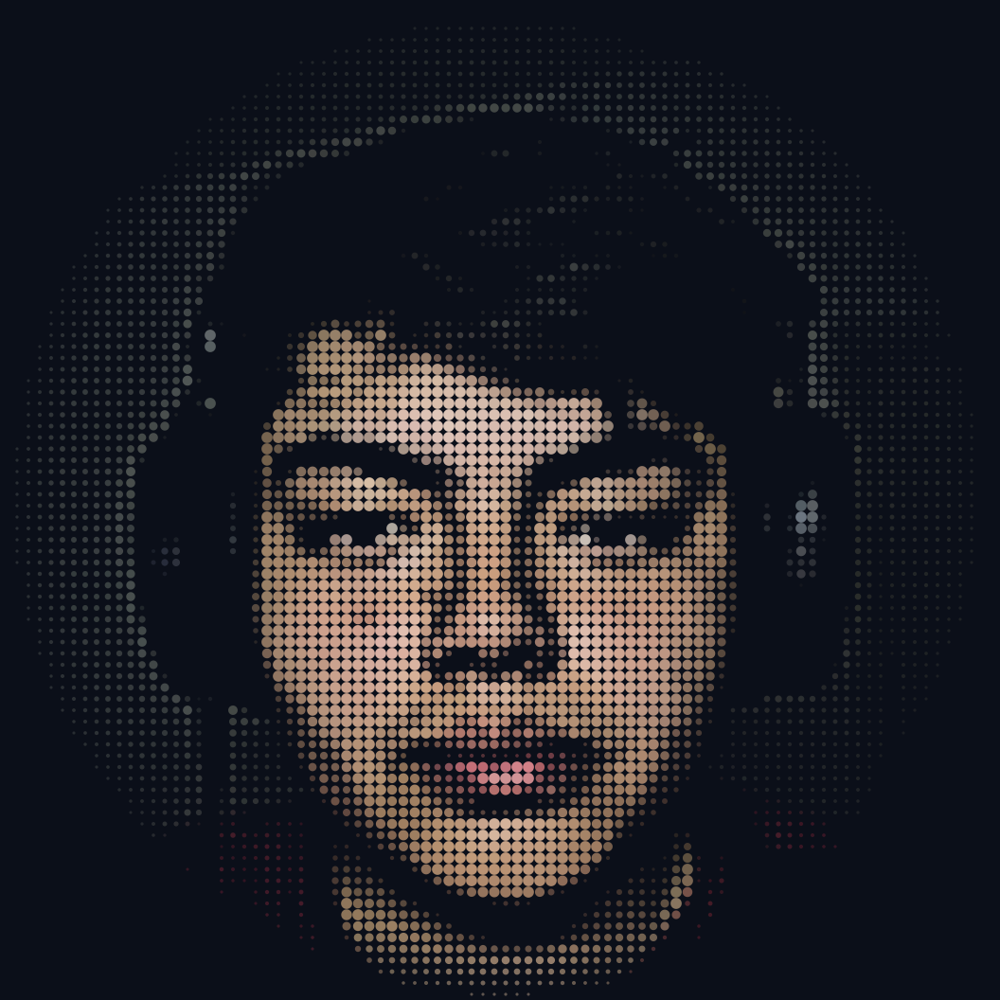

<div align="center">
  
  
  <a href="https://git.io/typing-svg">
    
  </a>
  <br/>

  <a href="https://github.com/sergio001gx2"></a>
  <a href="https://www.linkedin.com/in/sergio-gabriel-g%C3%B3mez-a19a63432"></a>
  <a href="mailto:sergio.gomezc13c@gmail.com"></a>
  

  <br/><br/>

  <a href="#about"><b>Sobre mí</b></a> &nbsp;·&nbsp; 
  <a href="#tech-stack"><b>Tecnologías</b></a> &nbsp;·&nbsp; 
  <a href="#featured-projects"><b>Proyectos</b></a> &nbsp;·&nbsp; 
  <a href="#github-analytics"><b>Estadísticas</b></a> &nbsp;·&nbsp; 
  <a href="#connect"><b>Contacto</b></a>
</div>

<br/>

<a id="about"></a>

> whoami

<table>
  <tr>
    <td width="36%" align="center" valign="middle">
      
      <br/>
      <sub><code>[dotface.svg · avatar]</code></sub>
    </td>
    <td width="64%" valign="top">

```yaml
nombre: Sergio Gómez
perfil: Tecnólogo en Desarrollo de Software
ubicación: Ecuador
intereses:
  - Desarrollo Web y Móvil
  - Backend, APIs y Bases de Datos
  - Ciberseguridad y Redes
  - IoT y Hardware
```

Me gusta crear proyectos útiles que funcionen bien: desde el diseño de la interfaz hasta el backend, las bases de datos y el despliegue. También me interesa bastante la seguridad informática y experimentar con electrónica e IoT.

</td>
  </tr>
</table>

<table>
  <tr>
    <td width="50%" valign="top">
      <b>// LO QUE HAGO</b>
      <br/><br/>
      • Aplicaciones web y móviles<br/>
      • APIs REST y servicios backend<br/>
      • Bases de datos SQL y NoSQL
    </td>
    <td width="50%" valign="top">
      <b>// EXPERIMENTANDO</b>
      <br/><br/>
      • Herramientas SIEM y seguridad defensiva<br/>
      • Docker y despliegues en la nube<br/>
      • Sensores y placas de desarrollo
    </td>
  </tr>
</table>

<a id="tech-stack"></a>

> tech_stack --list

<table>
  <tr>
    <td width="140"><sub><b>FRONTEND</b></sub></td>
    <td></td>
  </tr>
  <tr>
    <td><sub><b>BACKEND</b></sub></td>
    <td></td>
  </tr>
  <tr>
    <td><sub><b>MÓVIL</b></sub></td>
    <td></td>
  </tr>
  <tr>
    <td><sub><b>DATOS</b></sub></td>
    <td></td>
  </tr>
  <tr>
    <td><sub><b>DEVOPS Y TOOLS</b></sub></td>
    <td></td>
  </tr>
  <tr>
    <td><sub><b>EMBEBIDOS</b></sub></td>
    <td></td>
  </tr>
</table>

<a id="featured-projects"></a>

> ls ./proyectos

<table>
  <tr>
    <td width="50%" valign="top">
      <b>CSER Web Platform</b><br/>
      <sub>Plataforma web con diseño adaptable y accesible.</sub>
      <br/><br/>
      <code>Responsive</code> <code>Vercel</code>
      <br/><br/>
      <a href="https://cser-web-tau.vercel.app/"></a>
    </td>
    <td width="50%" valign="top">
      <b>CodeAcademy API</b><br/>
      <sub>Backend para plataforma de cursos y aprendizaje.</sub>
      <br/><br/>
      <code>Django REST</code> <code>PostgreSQL</code> <code>JWT</code>
      <br/><br/>
      <a href="https://github.com/sergio001gx2/CodeAcademy_bakend"></a>
    </td>
  </tr>
  <tr>
    <td width="50%" valign="top">
      <b>DJ Bee11 Apps</b><br/>
      <sub>Conjunto de aplicaciones web interactivas.</sub>
      <br/><br/>
      <code>Web Apps</code> <code>UI Design</code> <code>Vercel</code>
      <br/><br/>
      <a href="https://dj-bee11-sergio001gs-projects.vercel.app/"></a>
    </td>
    <td width="50%" valign="top">
      <b>ShieldFlow API Gateway</b><br/>
      <sub>Pasarela de servicios con autenticación y filtros de seguridad.</sub>
      <br/><br/>
      <code>Backend</code> <code>API Gateway</code> <code>Seguridad</code>
      <br/><br/>
      <a href="https://github.com/sergio001gx2/shieldflow-api-gateway"></a>
    </td>
  </tr>
</table>

### En desarrollo

<table>
  <tr>
    <td width="50%" valign="top">
      <b>SentinelSOC</b> &nbsp;<br/>
      <sub>Plataforma de monitoreo y detección de intrusiones a partir de logs.</sub>
      <br/><br/>
      <code>Python</code> <code>FastAPI</code> <code>React</code> <code>Docker</code>
    </td>
    <td width="50%" valign="top">
      <b>Monitoreo IoT</b> &nbsp;<br/>
      <sub>Lectura de sensores con Arduino y transmisión de datos a un panel web.</sub>
      <br/><br/>
      <code>Arduino</code> <code>C++</code> <code>Python</code> <code>MQTT</code>
    </td>
  </tr>
</table>

<a id="github-analytics"></a>

> github --stats

<div align="center">
  
  
  <br/><br/>
  
</div>

<br/>

<a id="connect"></a>

> connect --with-sergio

<div align="center">
  Si quieres hablar sobre desarrollo, colaborar en algún proyecto o intercambiar ideas, puedes escribirme:
  <br/><br/>

  <a href="https://www.linkedin.com/in/sergio-gabriel-g%C3%B3mez-a19a63432"></a>
  <a href="mailto:sergio.gomezc13c@gmail.com"></a>
  <br/><br/>

  
</div>
